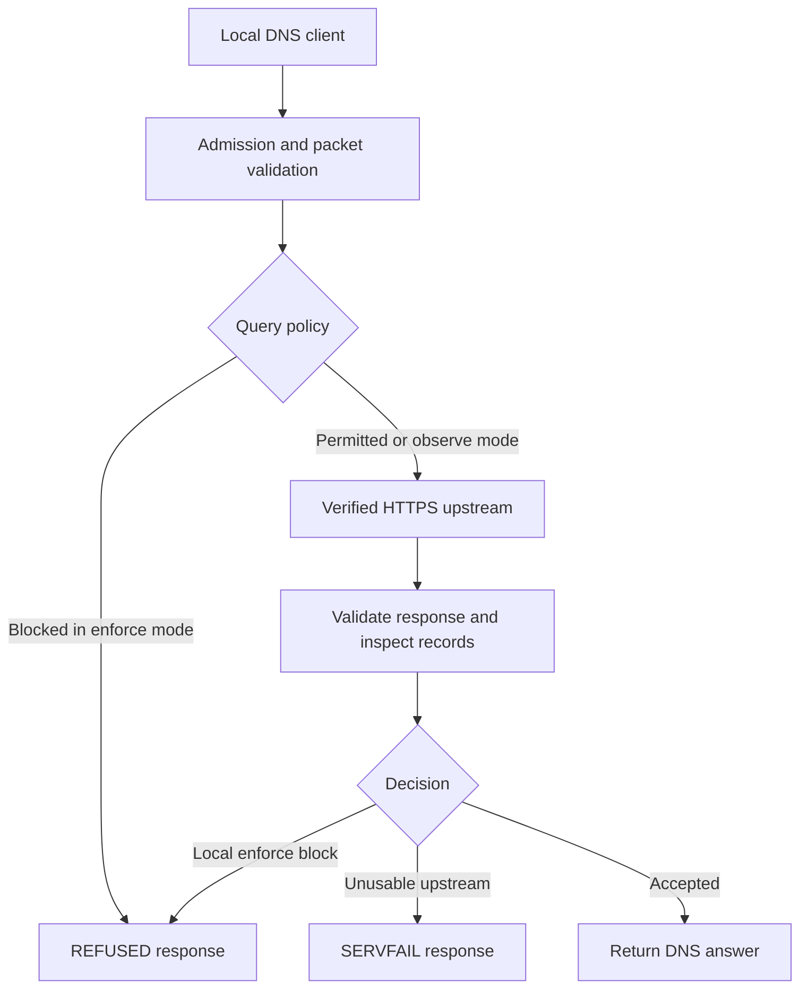

# Internet Guard

**A local protective DNS forwarder with explicit domain policy, response inspection, verified encrypted forwarding, and reproducible tests.**

Internet Guard implements one concrete defensive layer: it can refuse a DNS lookup before contacting an upstream resolver, and reject an answer containing a prohibited alias, address, or service-binding IP hint. Its policy is local and inspectable. Its source, example configuration, tests, and operational limits are included in this repository.

The broader objective is to reduce opportunities for malicious network connections, including connections made by software agents. Version **0.1.0** is an **experimental reference implementation**. Publishing this code does not deploy it on any device, establish Internet-wide protection, or demonstrate that endpoint security or AI safety has been solved.

| Project fact | Current state |
|---|---|
| Language | Python 3.11 or newer |
| Runtime dependency | `dnspython==2.9.0`, with a wheel hash in `requirements.lock` |
| Client protocols | DNS over local UDP and TCP |
| Default listener | `127.0.0.1:5533` |
| Listener exposure | Literal loopback addresses only |
| Default upstream | Quad9 DNS over HTTPS, with verified TLS |
| Policy modes | `enforce` and `observe` |
| Default policy | Allow unspecified domains; deny configured domains and non-global IP answers |
| Local validation | 60 tests passed; 12 offline demonstration checks passed |
| Malformed-input exercise | 3,000 deterministic inputs within the test suite |
| License | MIT |

## Contents

- [1. Implemented controls](#1-implemented-controls)
- [2. Protection boundaries](#2-protection-boundaries)
- [3. Architecture and request lifecycle](#3-architecture-and-request-lifecycle)
- [4. Requirements and installation](#4-requirements-and-installation)
- [5. Offline demonstration](#5-offline-demonstration)
- [6. Start a local resolver](#6-start-a-local-resolver)
- [7. Command-line reference](#7-command-line-reference)
- [8. Complete policy reference](#8-complete-policy-reference)
- [9. Domain matching and precedence](#9-domain-matching-and-precedence)
- [10. Response inspection and address rules](#10-response-inspection-and-address-rules)
- [11. Encrypted upstream behavior](#11-encrypted-upstream-behavior)
- [12. DNS protocol behavior](#12-dns-protocol-behavior)
- [13. Threat-feed imports](#13-threat-feed-imports)
- [14. Reload, rollback, and shutdown](#14-reload-rollback-and-shutdown)
- [15. Logs, privacy, and observability](#15-logs-privacy-and-observability)
- [16. Resource limits and availability](#16-resource-limits-and-availability)
- [17. AI-agent integration](#17-ai-agent-integration)
- [18. Device and network deployment](#18-device-and-network-deployment)
- [19. Tests and validation evidence](#19-tests-and-validation-evidence)
- [20. GitHub continuous integration](#20-github-continuous-integration)
- [21. Troubleshooting](#21-troubleshooting)
- [22. Source and developer guide](#22-source-and-developer-guide)
- [23. Security reporting and contributions](#23-security-reporting-and-contributions)
- [24. Outstanding engineering work](#24-outstanding-engineering-work)
- [25. References and license](#25-references-and-license)

## 1. Implemented controls

These controls apply to requests that actually pass through the guard:

| Control | Implemented behavior |
|---|---|
| Domain blocks | Refuse a configured domain and its descendants before upstream resolution in enforce mode |
| Strict allowlist | Refuse query names not explicitly permitted; inspect supported answer targets against the same policy |
| Explicit-deny precedence | A matching deny wins even when an allow rule also matches |
| Alias inspection | Examine supported target fields, including CNAME, DNAME, MX, SRV, SVCB, and HTTPS |
| Address inspection | Examine A/AAAA records and SVCB/HTTPS IPv4 and IPv6 hints |
| Non-global filtering | Reject non-global, multicast, and reserved answers unless the original query has a scoped exception |
| IP/CIDR denies | Reject matching addresses even when a private-address exception exists |
| Encrypted forwarding | Use HTTPS POST, CA trust, hostname verification, and an explicit bootstrap IP |
| Bounded processing | Limit message sizes, workers, query admission, client framing time, and upstream time |
| Policy updates | Validate the complete candidate before replacing the live immutable snapshot |
| Feed import | Normalize a reviewed local domains/hosts feed and atomically replace its output |
| Audit | Emit JSON decisions with a per-process keyed token for queried names |

The default upstream is the Quad9 endpoint documented for threat blocking and DNSSEC validation. That external service supplies live threat intelligence when reachable. The bundled local rules contain only `malware.test` and `phishing.test`: deliberate test fixtures, not a current malware dataset. Operators can add separately reviewed feeds or local rules.

## 2. Protection boundaries

**The protection boundary is the DNS path, not every network connection made by the device.**

| Scenario | Coverage |
|---|---|
| An application asks this resolver for a locally blocked domain | Refused in enforce mode before forwarding |
| An allowed lookup returns a supported alias to a blocked domain | The response is refused |
| A lookup returns a prohibited private or metadata-service address | Address policy is applied before returning the answer |
| SVCB/HTTPS returns a prohibited IP hint | The supported hint parameters are checked |
| A client connects directly to an IP address | Not controlled; no lookup may occur |
| A browser uses its own DNS or DoH service | Not controlled; it can bypass this listener |
| An application reuses a cached address or existing connection | No immediate revocation |
| Malicious content is hosted on an allowed domain | No payload inspection |
| A process has administrative control of the host | It can tamper with or bypass local controls |
| Prompt injection or unsafe tool execution | Not addressed by DNS filtering |
| Stolen credentials or unpatched software | No general prevention |
| An entire LAN, router, or ISP | This release rejects non-loopback listening addresses |

An accepted response means the local policy accepted a valid upstream response. It does not certify that a destination is harmless. A refusal can be a false positive. The program does not automatically decide which new domains should be considered malicious.

See [the threat model](docs/THREAT_MODEL.md) and [security status](SECURITY.md) for the trust boundaries and review limitations.

## 3. Architecture and request lifecycle



An admitted request follows this sequence:

1. The listener checks worker availability and the shared query budget.
2. The resolver validates message size, header shape, question count, class, request type, and parsing.
3. It takes one immutable policy snapshot. That snapshot remains attached to the request through any concurrent reload.
4. It checks the original query name. An enforce-mode block ends processing before upstream traffic.
5. It creates a fresh upstream question, removing client options that should not be forwarded.
6. It connects to the configured numeric IP and validates the TLS certificate against the HTTPS URL hostname.
7. It checks the HTTP status, media type, encoding, body bounds, and exchange deadline.
8. It validates DNS response correlation, parsing, question, response flag, truncation state, and EDNS version.
9. It examines supported names and addresses in answer, authority, and additional sections.
10. It returns a policy refusal, a failure, or an accepted response with the client's original transaction ID.
11. The normal policy-processing path emits a JSON decision event. Early protocol refusals and admission drops have different observability, documented below.

The guard is a forwarder. It does not perform iterative resolution from the DNS root, maintain authoritative zones, or locally validate DNSSEC signatures.

## 4. Requirements and installation

### Requirements

| Requirement | Purpose |
|---|---|
| Python 3.11+ | Runtime, TOML, sockets, TLS, HTTP, threading, and IP classification |
| `dnspython==2.9.0` | DNS parsing and message construction |
| Platform CA trust store | Authentication of the upstream HTTPS endpoint |
| Outbound TCP to the configured upstream | Real forwarding of nonlocally-blocked queries |
| Permission to bind a loopback port | Local UDP/TCP service |

The OpenSSL **command-line program** is needed for the full TLS test suite. Runtime forwarding uses Python's TLS support and does not invoke that executable. `dig` is optional and only used in manual examples.

### Linux and macOS

```bash
git clone https://github.com/infinitule/internet-guard.git
cd internet-guard
python3 -m venv .venv
.venv/bin/python -m pip install --require-hashes --only-binary=:all: -r requirements.lock
.venv/bin/python -m internet_guard --version
.venv/bin/python -m internet_guard demo
```

Run these commands from the repository root. The module command works directly from that source directory without installing the project itself.

### Windows PowerShell

```powershell
git clone https://github.com/infinitule/internet-guard.git
Set-Location internet-guard
py -3 -m venv .venv
.\.venv\Scripts\python.exe -m pip install --require-hashes --only-binary=:all: -r requirements.lock
.\.venv\Scripts\python.exe -m internet_guard --version
.\.venv\Scripts\python.exe -m internet_guard demo
```

Select Python 3.11 or newer. The recorded local validation was on Linux; macOS and Windows instructions describe the source workflow, not completed platform certification. Windows lacks the POSIX SIGHUP reload path, so restart to load a revised policy.

### Optional package installation

After installing the locked runtime dependency:

```bash
.venv/bin/python -m pip install --no-deps .
.venv/bin/internet-guard --version
```

This installs the console entry point. Building may fetch the backend declared in `pyproject.toml`; that build dependency is separate from the runtime hash lock. Running from the source directory avoids that build step.

The prepared downloadable archive also contains a wheel and a Git bundle. The GitHub repository contains the source, examples, documentation, and tests. None of these distribution formats automatically activate protection.

### Dependency integrity and upgrades

`requirements.lock` pins the runtime version and the hash of its universal wheel. `--require-hashes` checks the artifact; `--only-binary=:all:` avoids silently switching to a source build.

A hash is not a perpetual security guarantee. For an upgrade, review the release, update both `pyproject.toml` and the lock, regenerate the hash, and rerun validation. Do not remove verification to suppress an unexplained mismatch. Keep Python and its trust store maintained as well.

## 5. Offline demonstration

```bash
.venv/bin/python -m internet_guard demo
```

The demonstration creates a temporary policy, an in-process synthetic upstream, and real loopback UDP/TCP listeners on an ephemeral port. It makes no public DNS queries, changes no system settings, and cleans up its listeners and temporary files.

| Case | Synthetic behavior | Expected result |
|---|---|---|
| `domain` | Query `malware.test` | `REFUSED` |
| `subdomain` | Query `child.malware.test` | `REFUSED` |
| `alias` | CNAME points to `malware.test` | `REFUSED` |
| `private_answer` | A record contains `127.0.0.1` | `REFUSED` |
| `https_ip_hint` | HTTPS hint contains `169.254.169.254` | `REFUSED` |
| `allowed` | Answer contains a permitted public address | `NOERROR` |

Each case runs over UDP and TCP, for **12 checks**. Successful output includes `"offline": true`, `"synthetic_fixtures": true`, and `"passed": true`. A failed check produces exit code `1`.

This verifies implementation behavior, not malware-detection effectiveness. The `serve` command never selects the synthetic upstream.

## 6. Start a local resolver

Validate, then start:

```bash
.venv/bin/python -m internet_guard check --policy examples/guard.toml
.venv/bin/python -m internet_guard serve --policy examples/guard.toml
```

A JSON `ready` event on stderr identifies the actual address, port, policy revision, mode, and upstream hostname. **Ready means the local service started; it is not an upstream health check.**

In another terminal, if `dig` is available:

```bash
dig @127.0.0.1 -p 5533 malware.test A
dig @127.0.0.1 -p 5533 example.com A
dig @127.0.0.1 -p 5533 example.com A +tcp
```

The first should return `REFUSED` without an upstream exchange. The others require working public connectivity. Their returned addresses are not fixed expectations because DNS answers can change.

Stop with Ctrl-C or SIGTERM. These commands do not change operating-system DNS, routes, firewall rules, browser settings, or other devices.

IPv6 loopback can be selected explicitly:

```bash
.venv/bin/python -m internet_guard serve --policy examples/guard.toml --listen ::1
```

A single instance selects one listening address; it does not automatically bind both IPv4 and IPv6.

## 7. Command-line reference

```bash
.venv/bin/python -m internet_guard --help
.venv/bin/python -m internet_guard serve --help
.venv/bin/python -m internet_guard check --help
.venv/bin/python -m internet_guard import-feed --help
```

| Command | Purpose | Network behavior |
|---|---|---|
| `--version` | Display version | None |
| `check --policy FILE` | Validate policy and referenced feeds | None |
| `demo` | Run synthetic network checks | Loopback only |
| `import-feed --input FILE --output FILE` | Normalize a local feed | No automatic fetching |
| `serve --policy FILE` | Start the resolver | Local clients and configured upstream |

### Serve options

| Option | Default | Meaning |
|---|---|---|
| `--policy` | Required | TOML policy path |
| `--listen` | `127.0.0.1` | Literal loopback IP; hostnames and non-loopback addresses rejected |
| `--port` | `5533` | Shared TCP/UDP port; `0` requests an ephemeral port |
| `--upstream` | `https://dns.quad9.net/dns-query` | ASCII HTTPS URL without credentials, query string, or fragment |
| `--bootstrap` | `9.9.9.9` | Numeric upstream connection address |
| `--timeout` | `3.0` | Upstream exchange budget; range 0.1–30 seconds |
| `--workers` | `16` | Shared worker limit; range 1–128 |

When using port `0`, obtain the actual port from `ready`. Query rate, burst, client timeout, and connection query count are not CLI options in this version.

### Exit behavior

| Code | Meaning |
|---|---|
| `0` | Successful command or handled server shutdown |
| `1` | Demonstration check failure |
| `2` | Argument, configuration, or handled startup/file error |

OS signals and unexpected failures may produce other outcomes. A transient upstream failure normally produces a DNS failure response rather than exiting the service.

## 8. Complete policy reference

Policies are UTF-8 TOML. Unknown keys are rejected, making misspelled controls visible. Relative feed paths resolve against the policy's directory.

Every supported key appears here:

```toml
version = 1
mode = "enforce"
default_action = "allow"
block_domains = ["malware.test", "phishing.test"]
allow_domains = []
block_networks = []
block_non_global = true
allow_private_for = []
feed_files = []
```

| Key | Type | Default | Effect |
|---|---|---|---|
| `version` | Integer | Required | Exactly `1`; boolean `true` is not accepted as version 1 |
| `mode` | String | `"enforce"` | Enforce local policy or observe would-block decisions |
| `default_action` | String | `"allow"` | `block` requires an allow rule where strict name policy applies |
| `block_domains` | String array | `[]` | Explicit name denies, including descendants |
| `allow_domains` | String array | `[]` | Permitted names under default-deny; never overrides a deny |
| `block_networks` | String array | `[]` | IP literals or canonical CIDRs to reject |
| `block_non_global` | Boolean | `true` | Reject non-global, multicast, and reserved answers |
| `allow_private_for` | String array | `[]` | Original-query domains exempt from non-global rejection |
| `feed_files` | String array | `[]` | Local normalized domain files merged into denies |

In default-allow mode, `allow_domains` has no additional granting effect: otherwise unspecified domains already pass the name check. A private-address exception does not authorize a domain that strict name policy rejects, and never overrides an explicit network deny.

### Default-allow profile

[examples/guard.toml](examples/guard.toml) applies explicit local denies while the selected upstream applies its own filtering. Unknown domains can pass. This is the bundled default profile.

### Strict profile

```toml
version = 1
mode = "enforce"
default_action = "block"
allow_domains = ["api.example.com", "assets.example.net"]
block_domains = ["compromised.api.example.com"]
block_networks = []
block_non_global = true
allow_private_for = []
feed_files = []
```

Replace these illustrative names with approved destinations and required service aliases. A destination using a CDN CNAME may need both the service name and the relevant target permitted. [examples/agent-allowlist.toml](examples/agent-allowlist.toml) is another strict starting point.

### Observe profile

Set `mode = "observe"` to assess local policy effects. A valid reply that violates local policy is forwarded with `would_block`. An unusable upstream still fails. The upstream's independent filtering remains active; observe mode neither disables provider filtering nor enforces this program's local blocks.

## 9. Domain matching and precedence

Rules are normalized to lowercase ASCII label tuples. One trailing dot is accepted. Matching covers the domain and descendants separated by actual DNS label boundaries.

| Rule | Name | Matches? |
|---|---|---|
| `example.com` | `example.com` | Yes |
| `example.com` | `API.Example.Com.` | Yes |
| `example.com` | `a.b.example.com` | Yes |
| `example.com` | `notexample.com` | No |
| `example.com` | `example.com.attacker.test` | No |

An escaped dot inside one wire label is not split into two labels. Tests cover that distinction for strict allowlists.

### Rule syntax

Rules accept ASCII letters, digits, underscores, and valid internal hyphens, subject to the implemented label grammar. Labels are limited to 63 characters; textual domains to 253 characters after removing the optional trailing dot. International names must use explicit IDNA A-labels such as `xn--bcher-kva.test`.

URLs, wildcards, IP literals in domain lists, empty labels, surrounding whitespace, and raw non-ASCII names are rejected. The loader does not silently normalize Unicode names. Put IP addresses/ranges in `block_networks`.

Direct TOML rules can contain a single label; imported feeds deliberately reject single-label/TLD rules. A broad directly configured suffix can affect many queries and deserves careful review.

### Precedence

1. An explicit domain deny wins.
2. Otherwise, where strict name policy applies, default-deny requires an allow match.
3. Otherwise the name passes.
4. Returned addresses are evaluated independently.

There is no longest-match allow override. Allowing `safe.example.com` does not override denying `example.com`. Narrow the deny if that is the intended policy.

## 10. Response inspection and address rules

### Supported target fields

| Record | Inspected field |
|---|---|
| CNAME | `target` |
| DNAME | `target` |
| NS | `target` |
| PTR | `target` |
| MX | `exchange` |
| SRV | `target` |
| SVCB | `target` |
| HTTPS | `target` |
| NAPTR | `replacement` |

Every examined RRset owner is checked for explicit denies. Supported targets in the answer section receive the full name policy, including the strict allowlist. Supported targets in authority/additional sections receive explicit-deny checks, not the default-deny allowlist requirement. This avoids requiring every delegation name in an application's allowlist.

A root target (`.`) is not treated as an independent destination. Other applicable fields remain checked. NAPTR replacement names are inspected; its regular expressions are not interpreted. Opaque TXT, URI, ECH, and unknown record payloads are not generally interpreted as destinations.

### Addresses

A and AAAA records are checked in all response sections. SVCB/HTTPS `ipv4hint` and `ipv6hint` are checked because a client may use them without another address lookup.

Network rules use `ipaddress.ip_network(..., strict=True)`. Canonical `10.0.0.0/8` is accepted; host-bit-containing `10.0.0.1/8` is rejected. An IP literal becomes a single-address network.

With `block_non_global = true`, an address is rejected if Python classifies it as non-global, multicast, or reserved. Coverage includes loopback, private-use, link-local, shared-address, unspecified, and other special-use ranges. Classification details depend on the Python version.

The code also examines embedded IPv4 addresses in:

- IPv4-mapped IPv6.
- 6to4.
- Teredo server/client address components.
- The well-known NAT64 prefix `64:ff9b::/96`.

Custom translation prefixes and every possible application-specific encoding are not covered. Address filtering reduces some DNS-mediated access to local destinations; it is not a complete SSRF or rebinding boundary because the later application connection is not bound to or inspected by this resolver.

### Private exceptions

```toml
allow_private_for = ["internal.example.com"]
```

This matches the **original query name**, not each alias. It relaxes non-global rejection for that query's returned addresses. Explicit CIDRs still apply, and the domain still needs to pass name policy. Check whether the configured upstream can resolve the intended internal zone before adding exceptions.

## 11. Encrypted upstream behavior

Default endpoint: `https://dns.quad9.net/dns-query`; bootstrap: `9.9.9.9`; timeout: 3 seconds. Quad9 documents this endpoint's filtering and DNSSEC behavior in its [service-address documentation](https://quad9.net/service/service-addresses-and-features/). Changing providers changes the external service's trust, privacy, availability, and filtering properties.

| Aspect | Behavior |
|---|---|
| Bootstrap | Direct connection to the configured numeric IP; no system-DNS bootstrap lookup |
| Identity | Verify the certificate against the HTTPS URL hostname |
| Trust | Platform CA roots; mandatory hostname checking and `CERT_REQUIRED` |
| TLS | Minimum version 1.2 |
| HTTP | HTTP/1.1 POST with `application/dns-message` |
| Connection lifecycle | Fresh connection per exchange; no pool |
| Redirects | Rejected |
| Media type | Require `application/dns-message`; media-type parameters tolerated |
| Content encoding | Identity only |
| Transfer encoding | Chunked supported; unsupported/ambiguous framing rejected |
| Body size | At most 65,535 bytes |
| Deadline | Exchange budget with interruption of slow-drip HTTP traffic |
| Proxies | Environment HTTP proxy settings ignored |
| Fallback | No plaintext DNS fallback or redundant upstream |

`PinnedHTTPSConnection` means a fixed bootstrap address, **not certificate pinning**. Normal CA/hostname verification remains required. The provider sees queried names and the deployment's source address; encryption does not hide queries from that provider.

### DNSSEC and options

The outgoing query is rebuilt. Client ECS, cookies, padding, arbitrary extra records, and the CD flag are not forwarded as supplied. The DO request for DNSSEC records is preserved. The upstream's AD assertion can be returned when the client requests AD or DNSSEC records; it is not local cryptographic validation.

Only upstream EDE options are retained on accepted responses; other upstream options are removed. This is deliberately a restricted forwarding surface rather than transparent transport for arbitrary extensions.

### Cache behavior

There is no local DNS answer cache. HTTP `Age` reduces returned RRset TTLs, including SOA negative-cache handling, so a cached HTTP reply does not regain its original DNS lifetime. Invalid Age values cause failure.

Clients can still cache accepted answers. A policy change cannot revoke an address already known by a client or terminate an existing connection.

## 12. DNS protocol behavior

The request surface is one standard Internet-class question, bounded input, and supported EDNS handling. Unexpected sections and unsupported operations are refused or rejected rather than relayed arbitrarily.

| Condition | Behavior |
|---|---|
| Local enforce-mode policy violation | Synthetic `REFUSED`; EDE 15 for EDNS clients |
| Upstream failure or unusable response | Synthetic `SERVFAIL`; EDE 23 for EDNS clients |
| Certain malformed headers/parses | Minimal `FORMERR` |
| Too-short/oversized input, incoming response, admission failure | May be dropped without a DNS response |
| Unsupported class, operation, or request structure | `REFUSED` or structural rejection |
| Valid upstream NXDOMAIN | Forwarded subject to validation and policy |
| Accepted reply above UDP budget | Serializer truncation, allowing TCP retry |

ANY, AXFR, IXFR, OPT, TSIG, TKEY, MAILA, MAILB, and type zero are refused as query types. DNS UPDATE, zone transfer, TSIG authentication, and future EDNS versions are unsupported.

Upstream replies must correspond to the request and contain exactly the expected question. Truncated DoH replies are unusable; the guard does not retry another upstream protocol.

Without EDNS, client-facing UDP is limited to 512 bytes. With EDNS, the advertised budget is capped at 1,232 and never reduced below 512. TCP uses standard two-byte framing and permits a DNS message up to 65,535 bytes.

Synthetic refusals do not falsely assert authoritative origin or DNSSEC authentication. Accepted replies restore the original client transaction ID and question.

## 13. Threat-feed imports

The importer reads an **operator-selected local file**. It does not fetch feeds, authenticate publishers, schedule refreshes, verify signatures, assess licensing, or prove an entry is malicious.

### Formats

Domain-format fixture:

```text
# Example only
malware.test
phishing.test
```

Hosts-format fixture:

```text
0.0.0.0 malware.test phishing.test
127.0.0.1 another.test
```

Hosts sink values may be `0.0.0.0`, `127.0.0.1`, `::`, or `::1`. These are input-file values, not bind addresses. Standard `localhost` and `localhost.localdomain` entries are ignored in hosts input.

Both formats support `#` comments, empty lines, UTF-8 with optional BOM, normalization, and deduplication. Invalid domains, unexpected formats, non-UTF-8 content, empty results, and single-label/TLD feed rules fail validation.

### Import, validate, activate

```bash
.venv/bin/python -m internet_guard import-feed \
  --input reviewed-hosts.txt \
  --format hosts \
  --output examples/threats.domains
```

Add the normalized file to the policy:

```toml
feed_files = ["threats.domains"]
```

Then validate before a reload:

```bash
.venv/bin/python -m internet_guard check --policy examples/guard.toml
```

Use `--format domains` for one-domain-per-line input. Referenced `feed_files` always use normalized domain format; raw hosts files are not interpreted as hosts format during policy loading.

The full input is validated before output changes. The importer writes and flushes a temporary file in the destination directory, atomically replaces the target, and syncs the directory on supported POSIX systems. Output includes the input SHA-256 as provenance metadata. This is not a publisher signature or a threat-accuracy certificate.

Input and output must differ. The destination parent must exist. An invalid import leaves an existing valid output unchanged. Keep original feed provenance, freshness, license, and rollback records separately; operational data should not be published accidentally.

### Policy and feed limits

| Item | Limit |
|---|---|
| TOML input | 2 MiB |
| Each feed input | 16 MiB |
| Referenced files | 16 |
| Combined domain sets | 100,000 blocked, allowed, and private-exception entries |
| Explicit network rules | 1,024 |

Duplicates within a domain set are deduplicated. Feed entries merge into the deny set. Feed expiry and stale-feed warnings are not implemented; freshness remains an operator responsibility.

## 14. Reload, rollback, and shutdown

### POSIX reload

After validating new configuration:

```bash
kill -HUP <guard-process-id>
```

Replace the placeholder with the actual PID. The signal handler only requests a reload. The main loop parses the candidate and feeds, then replaces the live snapshot after complete validation.

Success emits `policy_reloaded`. A handled file/validation failure emits `policy_reload_rejected` and retains the last valid snapshot. In-flight requests finish with their original policy.

### Rollback

Restore the previous approved policy and feeds using atomic file replacement, run `check`, and reload. This affects future lookups; it does not flush client caches or undo connections. No remote configuration service or automatic updater is installed. Protect configuration write access separately.

### Stop

Ctrl-C and SIGTERM request shutdown. Listeners stop accepting work; handlers stop proceeding to new requests when they observe shutdown; active work finishes within its I/O controls. Shutdown is not instantaneous.

The default launch changes no host network settings. If a later deployment changes OS DNS or routes independently, record and restore those separately. Stopping this program cannot reconstruct previous host configuration.

## 15. Logs, privacy, and observability

Audit output is JSON lines on stderr. A normal policy decision records event, timestamp, policy revision, mode, numeric query type, transport, elapsed time, reason, and a keyed name token.

Illustrative placeholders, not a real incident:

```json
{
  "time": "2026-10-29T00:00:00+00:00",
  "event": "blocked",
  "reason": "blocked_domain",
  "policy": "<policy-revision>",
  "mode": "enforce",
  "qtype": 1,
  "transport": "udp",
  "elapsed_ms": 0.12,
  "name_token": "<per-process-keyed-token>"
}
```

| Event | Meaning |
|---|---|
| `ready` | Local listeners started; includes configured endpoint information |
| `blocked` | Local enforce policy refused the query or answer |
| `would_block` | Observe mode forwarded a valid reply violating local policy |
| `forwarded` | Local policy accepted a valid upstream DNS result |
| `upstream_error` | Transport or response unusable |
| `malformed` | A handled size/header/parser rejection |
| `policy_reloaded` | Validated snapshot installed |
| `policy_reload_rejected` | Invalid update rejected while the old snapshot remains |
| `internal_error` | Unexpected error caught at the request-handler boundary |
| `stopped` | Shutdown, including aggregate admission rejections |

`forwarded` can include a valid NXDOMAIN or provider-generated policy result. The guard does not infer every provider block from a negative DNS answer.

### Token construction and privacy

The token is the first 32 hexadecimal characters of HMAC-SHA256 over the canonical DNS wire name, using a randomly generated 32-byte key. The key stays in process memory and is not persisted. Tokens repeat within a run and change on restart.

Normal query audit records omit plaintext queried names and query-client IPs. Startup records include the configured local address and upstream hostname. Configuration errors can describe invalid operator-supplied values.

Logs are pseudonymous, not anonymous: timing, frequency, query types, and repeated tokens reveal patterns. There is no stored reverse mapping or exported key to decode the token later.

### Observability limits

There is no built-in dashboard, HTTP metrics endpoint, event database, or log rotation. Some early protocol refusals lack per-query events. Admission rejections are counted and summarized at stop instead of producing one event per dropped request.

A broken audit sink increments an in-memory audit-write-error counter without turning blocks into allows. A slow stderr consumer can still affect performance. Configure bounded retention and access controls in an external supervisor if retaining logs.

## 16. Resource limits and availability

| Resource | Default/bound | Configuration |
|---|---|---|
| Worker slots | 16, range 1–128 | `--workers` |
| Shared query rate | 100/second | `GuardServer` constructor |
| Burst | 200 | `GuardServer` constructor |
| Client TCP frame deadline | 2 seconds | `GuardServer` constructor |
| Queries per TCP connection | 16 | Handler constant |
| Requested accept backlog | 32 | Server class; OS semantics apply |
| Upstream budget | 3 seconds, range 0.1–30 | `--timeout` |
| Query size | 4,096 bytes | Resolver/server constant |
| Upstream DNS body | 65,535 bytes | Transport constant |
| Client UDP message | 1,232 with EDNS; 512 without | Resolver/client budget |

UDP and TCP share workers. A TCP connection occupies a worker while handled, including frame waits. Semaphore admission prevents an unbounded executor work queue. Saturated UDP work can be dropped and TCP connections closed.

These controls bound specific paths. They do not prove resistance to every same-host denial-of-service attack, cap all kernel queues, or establish a throughput guarantee.

A fresh HTTPS connection per query favors a simple lifecycle over throughput. There is no cache, retry policy, redundant upstream, health-based failover, or connection pool. An upstream outage produces SERVFAIL. Availability must be designed and measured before making dependent applications rely on the service.

## 17. AI-agent integration

Use the strict sample in an isolated experiment and replace its example domains with approved destinations.

1. Inventory the agent's necessary destinations and service aliases.
2. Create a narrow allowlist; retain non-global restrictions unless specific internal access is needed.
3. Configure the test environment to send DNS to this listener.
4. Verify denied lookups do not trigger another resolver, alternative DoH, or hard-coded IP access.
5. Independently enforce the intended egress path outside the agent's authority.
6. Separately constrain tool credentials, file access, data disclosure, and external actions.
7. Test permitted work, denied work, failure, and recovery before depending on the setup.

Sandbox, firewall, credential, and human-approval controls in that sequence are **not implemented here**. An allowed domain can still receive exfiltrated data or serve malicious content. DNS cannot establish whether a tool call is authorized or an instruction trustworthy.

The guard does not inspect prompts, model weights, HTTP bodies, or tool arguments, and does not execute AI-generated remediation commands.

## 18. Device and network deployment

### Applications

An application supporting a custom DNS server and port can use `127.0.0.1:5533` in a test setup. Confirm TCP retry and verify it does not silently choose another resolver.

### Operating-system resolver

Ordinary OS DNS configuration generally expects port 53, not 5533. Integration may require an existing local resolver forwarding to this service or a reviewed local port-53 service setup. This repository installs neither.

Running the whole process as root to obtain a privileged port broadens the impact of defects. Review a least-privilege platform service mechanism separately. No installer here changes resolver files or grants capabilities.

### Containers

Loopback belongs to a network namespace. A container's `127.0.0.1` does not automatically reach a guard in another container or on the host. This release provides no Docker image, Compose network, or automatic namespace wiring.

### Phones and tablets

This is Python source, not an iOS/Android protection app or device-management profile. VPN/private-DNS integration and background execution require separate platform implementations.

### LANs, routers, and ISPs

Non-loopback binding is rejected. Wider deployment needs client isolation, abuse prevention, high availability, network policy, and compatibility work that has not been completed here.

### Acceptance checks

Verify the actual DNS path, permitted and denied workflows, IPv4/IPv6 behavior, false positives, upstream failures, stale caches, logs, and rollback. A running process and a successful demo do not establish that intended applications use the resolver.

## 19. Tests and validation evidence

```bash
.venv/bin/python -m unittest discover -s tests -v
```

The suite uses standard-library `unittest`, not pytest, and does not query real malware infrastructure.

| Module | Coverage |
|---|---|
| `tests/test_policy.py` | Label boundaries, strict inputs, precedence, special addresses, exceptions, feed imports, revisions, reload behavior |
| `tests/test_resolver.py` | Pre-upstream blocks, aliases/hints, address responses, sanitization, correlation, truncation, audit privacy, malformed inputs |
| `tests/test_server.py` | Real UDP/TCP, framing, IPv6 loopback, idle clients, admission limits, loopback restriction |
| `tests/test_upstream.py` | Local HTTPS, CA/hostname failures, HTTP/body limits, Age, chunking, slow-drip deadlines |

TLS tests generate ephemeral certificates using the OpenSSL CLI. No reusable private test key is committed. If OpenSSL is unavailable, those tests are explicitly skipped; inspect skip counts before claiming full coverage.

### Recorded local evidence

Linux, CPython 3.12.14, dnspython 2.9.0:

- 60 tests passed, with no skips.
- All 12 offline UDP/TCP demonstration checks passed.
- The deterministic malformed-wire test exercised 3,000 inputs without an uncaught exception in that test.
- Ruff 0.17.3 passed the configured lint rules.
- Hash-verified installation succeeded in a clean environment.
- The wheel was built and its Python modules checked against source.
- The installed CLI passed start, UDP block, SIGHUP reload, invalid-update retention, and shutdown checks.
- pip-audit 2.10.1 reported no known vulnerabilities for the pinned runtime dependency at check time.

The audit is an advisory-database query, not an independent source review. It excludes Python/OS components and undisclosed vulnerabilities. Its result is retained in [docs/dependency-audit.json](docs/dependency-audit.json).

The malformed-input corpus is a deterministic regression exercise, not exhaustive fuzzing. No production throughput, malware block rate, uptime, or worldwide impact was measured.

### Unverified public-upstream path

The preparation runtime could not reach public Quad9 and reported `OSError: [Errno 101] Network is unreachable`. Local TLS tests exercise the implementation but do not verify public routing, provider availability, live detections, or target-device trust-store compatibility.

See [docs/VALIDATION.md](docs/VALIDATION.md) for the evidence record. Remote Actions outcomes must be read from actual runs; local results do not establish a remote matrix pass.

## 20. GitHub continuous integration

[.github/workflows/verify.yml](.github/workflows/verify.yml) runs on push, pull request, and manual dispatch, with Python **3.11, 3.12, 3.13, and 3.14**.

Each job checks out pinned-action source, selects Python, installs the hashed dependency, requires OpenSSL, runs all tests, runs the demo, validates both sample policies, and compiles source.

The workflow requests read-only repository contents permission, disables persisted checkout credentials, and has a ten-minute job timeout. It does not deploy software, alter host DNS, publish packages, or run the public-upstream probe. The recorded lint/audit checks were local; those tools are not installed by this workflow.

Action commits were resolved from the official checkout/setup-python v6 tag API responses during preparation. Review and update pins deliberately.

## 21. Troubleshooting

| Symptom | Explanation and next check |
|---|---|
| `ModuleNotFoundError: dns` | Install the lock with the same virtual-environment interpreter used to run the service |
| `ModuleNotFoundError: internet_guard` | Work from the source root or install the package |
| Address already in use | Select an unused port or identify the existing service; do not terminate unrelated processes |
| Ready event but public SERVFAIL | Startup is not a health check; inspect connectivity, bootstrap IP, hostname, CA trust, clock, and provider availability |
| Local block succeeds but public lookup fails | Local policy is independent of upstream availability; diagnose forwarding |
| Legitimate service receives REFUSED | Review event reason, domain/alias policy, CIDRs, and private-address handling |
| Allow rule seems ineffective | Explicit deny wins; alias or address rules may also block |
| Internal service is refused | Assess a narrow private-address exception and whether the upstream knows that zone |
| Browser still connects after a block | It may use a cache, existing connection, different resolver, or direct address; verify its actual path |
| UDP is truncated | Confirm client TCP retry |
| Hosts feed rejected | Check the selected format, sink values, and invalid entries; do not silently discard errors |
| Reload rejected | Run `check`; the old snapshot remains active |
| Policy change does not affect a connection | DNS decisions do not revoke cached addresses or existing connections |
| Logs contain tokens | Pseudonymization is intentional; there is no stored reverse mapping |
| TLS tests skipped | Install the OpenSSL CLI before claiming complete TLS-test coverage |
| HTTP upstream rejected | Plaintext is unsupported; configure authenticated HTTPS and its bootstrap IP |
| LAN bind rejected | This release deliberately supports loopback only |

Do not disable certificate validation to fix a TLS error. The transport rejects contexts with disabled CA or hostname checks; resolve the underlying trust, identity, clock, or connectivity issue.

## 22. Source and developer guide

### Repository map

| Path | Responsibility |
|---|---|
| `internet_guard/__init__.py` | Version |
| `internet_guard/__main__.py` | CLI, signals, reload loop, lifecycle events |
| `internet_guard/policy.py` | Immutable policy, matching, loading, revisions, imports |
| `internet_guard/resolver.py` | DNS validation, decisions, response inspection, synthetic replies, audit |
| `internet_guard/upstream.py` | Verified HTTPS, framing/bounds, deadlines, Age handling |
| `internet_guard/server.py` | UDP/TCP, admission, framing, lifecycle |
| `internet_guard/demo.py` | Synthetic upstream and local demonstration |
| `examples/` | Default and strict profiles |
| `tests/` | Regression/integration suite |
| `docs/THREAT_MODEL.md` | Trust boundaries and uncovered paths |
| `docs/OPERATIONS.md` | Operations and archive instructions |
| `docs/VALIDATION.md` | Recorded checks and limitations |
| `SECURITY.md` | Review/reporting status |
| `requirements.lock` | Runtime version and wheel hash |
| `pyproject.toml` | Packaging, entry point, build backend, lint configuration |

### Internal interfaces

| Interface | Contract |
|---|---|
| `load_policy(path)` | Validate a complete policy or raise |
| `Policy.name_reason(name, explicit_only=False)` | Violation reason or `None` |
| `Policy.address_reason(value, origin)` | Evaluate IP rules with original-query exception scope |
| `PolicyStore.snapshot()` | Current immutable snapshot |
| `PolicyStore.reload()` | Validate before replacing the snapshot |
| `GuardResolver.handle(wire, transport)` | Response bytes or `None` for a drop |
| `DoHUpstream.exchange(wire)` | Bounded response bytes or `UpstreamError` |
| `GuardServer.start()/close()` | Listener/worker lifecycle |
| `Audit.emit(event, **fields)` | JSON event with supplied DNS names tokenized |

These are pre-1.0 implementation interfaces, not a stable API promise. Tests inject a fixture implementing `exchange` to exercise policy without public traffic.

### Optional development tools

```bash
.venv/bin/python -m pip install ruff==0.17.3 pip-audit==2.10.1
.venv/bin/ruff check internet_guard tests
.venv/bin/ruff format --check internet_guard tests
.venv/bin/python -m unittest discover -s tests -v
.venv/bin/python -m internet_guard demo
.venv/bin/python -m compileall -q internet_guard
.venv/bin/pip-audit -r requirements.lock --require-hashes --disable-pip
```

These tool pins are not a complete hash lock of their transitive dependencies. Use a separate tooling environment when keeping runtime minimal. The audit needs its advisory data service.

Production lint includes correctness and security-oriented rules. Test suppressions cover intentional negative fixtures and deterministic random inputs. The hosts sink literal is annotated because it is not a public listening address.

## 23. Security reporting and contributions

Use private GitHub vulnerability reporting if the owner has enabled it. Otherwise request a private channel without publishing exploit details, credentials, or DNS logs. See [SECURITY.md](SECURITY.md). There is no staffed response service or remediation SLA.

Contributions should explain the concrete behavior, threat-model effect, and supporting evidence. For a fix, include a regression test showing the previous failure. Use fixtures or infrastructure you control.

Review changes for certificate validation, unexpected fallback, response correlation, label boundaries, deny precedence, service hints, additional records, address encodings, resource bounds, failure behavior, privacy, and compatibility. Keep secrets, operational feeds/policies, logs, temporary certificates, and environments out of public commits. Ignore rules do not replace staged-content review.

## 24. Outstanding engineering work

These areas are **not complete**:

| Area | Work needed before stronger claims |
|---|---|
| Independent review | Assess parser, transport, policy, error paths, and trust assumptions |
| Fuzzing | Coverage-guided and stateful protocol testing beyond the corpus |
| Compatibility | Real clients/resolvers, DNSSEC behavior, and OS versions |
| Performance | Sustained load, memory, latency, and saturation measurements |
| Availability | Reviewed redundancy, health checks, connection reuse, recovery |
| Feed governance | Authenticated provenance, expiry, false-positive review, rollback |
| Enforced egress | Firewall/proxy/sandbox integration outside application authority |
| Device packaging | OS services, mobile integration, installation and rollback |
| Network service | Client isolation and abuse prevention before LAN/public listening |
| Agent safety | Tool authorization and data-access controls beyond DNS |

This is a list of gaps, not promised delivery dates or background work running automatically. No universal-defense or life-critical suitability claim is made.

## 25. References and license

- [RFC 1035: DNS implementation and specification](https://www.rfc-editor.org/rfc/rfc1035).
- [RFC 8484: DNS queries over HTTPS](https://www.rfc-editor.org/rfc/rfc8484).
- [RFC 8914: Extended DNS Errors](https://www.rfc-editor.org/rfc/rfc8914).
- [dnspython release notes](https://dnspython.readthedocs.io/en/stable/whatsnew.html), including the 2.9.0 name-decompression CPU-consumption fix that informed the dependency choice.
- [Quad9 service addresses and features](https://quad9.net/service/service-addresses-and-features/).

The parser and default provider are independent projects. No affiliation, endorsement, or warranty from them is implied.

Internet Guard uses the [MIT License](LICENSE); dependencies retain their own licenses. Source and local evidence are available for inspection and do not substitute for deployment-specific validation.
